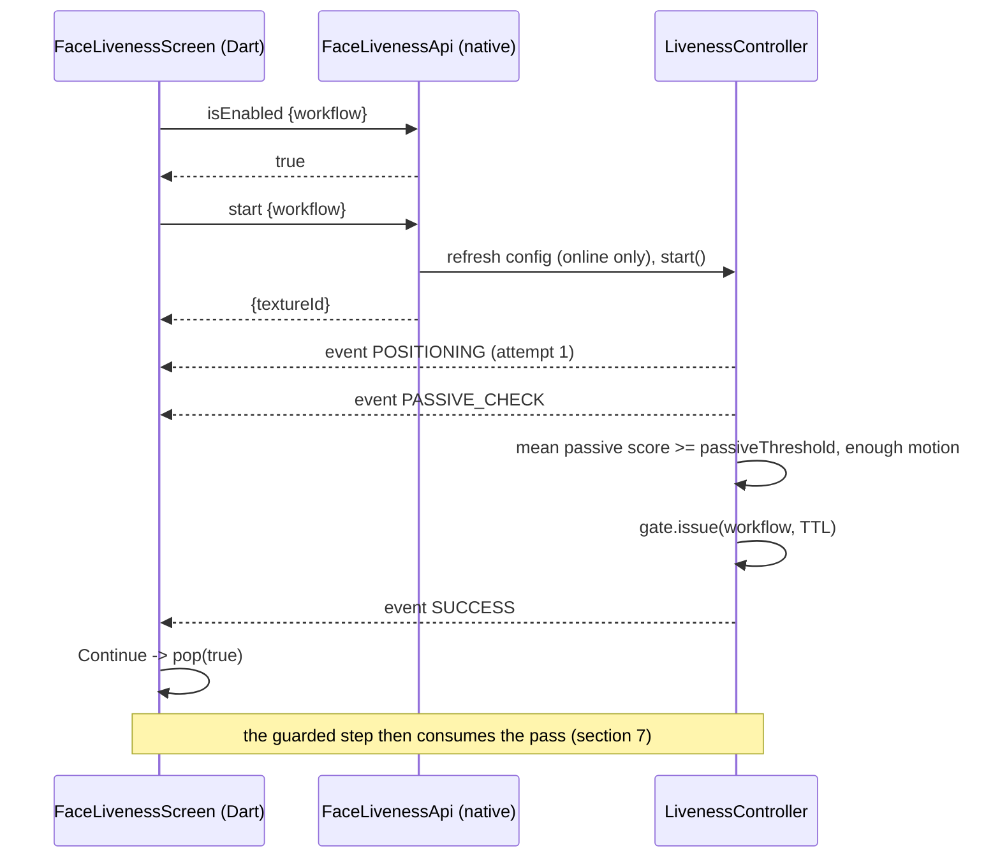
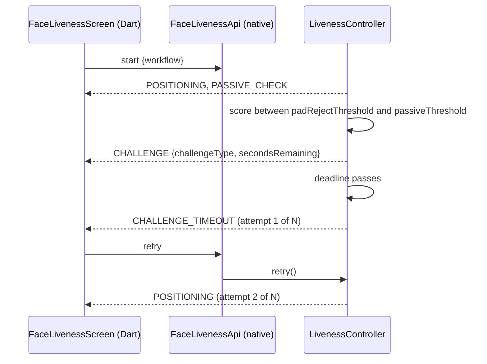

# Face liveness + PAD: API reference

On-device API of the face liveness and presentation attack detection (PAD) feature in the Android client (repository root) and the Desktop client (`desktop/`). Written from the source; anything not found in code says so.

## 1. Overview

- The feature exposes: a Flutter bridge (one MethodChannel, one EventChannel) on Android, a Java service and controller on Desktop, a config global parameter, six audit events and a single-use liveness gate.
- Callers: the Flutter UI (Android) and the JavaFX controllers (Desktop). There is no remote caller.
- Everything runs on the device. No network call is made in any liveness decision path.
- **Authentication does not apply.** The bridge is an in-process platform channel and has no network listener. It is protected by the gate instead: a pass is kept in process memory only, is single use, expires after a TTL, and a guarded step is refused without one (section 7).
- Scores, thresholds, model names and attack types never reach the UI. They exist only in audit records (section 8); `LivenessEvent` has no field that can hold them.

## 2. Bridge API (Flutter <-> native, Android)

Channels (`FaceLivenessApi.java`, `lib/platform_android/face_liveness_service_impl.dart`):

| Channel | Name |
|---|---|
| MethodChannel | `io.mosip.registration_client/face_liveness` |
| EventChannel | `io.mosip.registration_client/face_liveness/events` |

### 2.1 Commands

`workflow` is `RESIDENT`, `OPERATOR` or `SUPERVISOR` (native `Workflow.fromValue` also accepts the config key `resident` etc., case-insensitive).

| Method | Direction | Arguments | Returns | Errors |
|---|---|---|---|---|
| `isEnabled` | Dart -> native | `{workflow}` | `bool`: policy `enabled` | see below. The Dart wrapper returns `true` on a `PlatformException` (fail closed) |
| `getMaxAttempts` | Dart -> native | `{workflow}` | `int`: `max(1, maxRetries)`. Dart returns `3` on error | see below |
| `start` | Dart -> native | `{workflow}` | `{textureId: int}`; the camera preview is a Flutter texture. States follow on the event stream | see below. Device, camera and engine failures arrive as events, not as call errors |
| `retry` | Dart -> native | none | `null`. No-op unless the state is retryable | |
| `cancel` | Dart -> native | none | `null` | |
| `setSource` | Dart -> native | `{source: "mock"\|"camera", path?: String, mirrored?: bool}` | `bool`; always `false` in release builds | debug builds only |
| `onPreviewTransform` | native -> Dart | `{width, height, rotationDegrees, mirror}` | ignored | none |

Call errors: `LIVENESS_BAD_ARGUMENT` ("Invalid argument": missing or unknown `workflow`), `LIVENESS_ERROR` ("Liveness unavailable": any other runtime exception), `notImplemented` for an unknown method name.

`start` also: re-reads the synced config when the network is up, and revokes any earlier pass of that workflow.

### 2.2 Event stream

Each event is a map built by `LivenessEvent.toMap()`. Keys are always present; unused ones are `null`. Events are posted on the main thread; an event equal to the previous one is not re-sent.

| Field | Type | Present (non-null) |
|---|---|---|
| `state` | string, a `LivenessState` name | always |
| `workflow` | string, `RESIDENT` / `OPERATOR` / `SUPERVISOR` | always |
| `attempt` | int, 1-based | always |
| `maxAttempts` | int | always |
| `challengeType` | `BLINK` / `SMILE` / `TURN_LEFT` / `TURN_RIGHT` | only in `CHALLENGE` |
| `secondsRemaining` | int | only in `CHALLENGE` |
| `hint` | `LIGHTING` / `FAR` / `BLURRY` | only in `POOR_QUALITY` |

Dart parsing (`FaceLivenessEvent.fromMap`): names are matched as camelCase <-> UPPER_SNAKE; an unknown `state` becomes `engineError` (fail closed).

### 2.3 States and the UI message each one triggers

Message keys are in `assets/l10n/app_*.arb` (Android) and `labels_*.properties` (Desktop, same keys, table in `DesktopLivenessUiModel`). Text comes from `LivenessCopy.forEvent` (`lib/ui/face_liveness/liveness_copy.dart`).

| State | Message key(s) |
|---|---|
| (before start) | `liveness_intro_title`, `liveness_intro_body`, button `liveness_start` |
| `IDLE`, `POSITIONING` | `liveness_state_position_face`, `liveness_state_look_camera` |
| `PASSIVE_CHECK` | `liveness_state_checking`, `liveness_state_hold_still` |
| `CHALLENGE` | by `challengeType`: `liveness_challenge_blink` / `_smile` / `_turn_left` / `_turn_right` (`liveness_challenge_generic` if null); progress `liveness_challenge_number`, `liveness_challenge_next`; screen-reader countdown `liveness_semantics_countdown` |
| `SUCCESS` | resident: `liveness_state_success`. Operator and supervisor: `liveness_state_success_auth` + `liveness_state_success_auth_hint` |
| `LIVENESS_FAILED` | `liveness_state_failed` |
| `PAD_FAILED` | `liveness_state_pad_failed` (generic; no reason shown) |
| `CHALLENGE_TIMEOUT` | `liveness_state_timeout` |
| `NO_FACE` | `liveness_state_no_face` |
| `MULTIPLE_FACES` | `liveness_state_multiple_faces` |
| `POOR_QUALITY` | by `hint`: `liveness_hint_lighting` / `liveness_hint_far` / `liveness_hint_blurry` |
| `DEVICE_UNAVAILABLE` | `liveness_state_camera_unavailable` |
| `CAMERA_ERROR` | `liveness_state_camera_error` + `liveness_state_camera_error_hint` |
| `INVALID_FRAMES` | `liveness_state_invalid_frames` + `liveness_state_invalid_frames_hint` |
| `ENGINE_ERROR` | `liveness_state_engine_error` |
| `MAX_RETRIES` | `liveness_state_max_retries` (`{maxAttempts}`); the recovery dialog uses `liveness_recovery_title`, `liveness_recovery_body_resident` / `_staff`, `liveness_recovery_stay`, `liveness_recovery_return` |

Buttons: failure states show `liveness_try_again` and `liveness_cancel`. System errors show `liveness_retry_connection` for `DEVICE_UNAVAILABLE` and `liveness_try_again` for the others. `MAX_RETRIES` shows `liveness_recovery_options`.

### 2.4 Sequences

Passive pass:



Low passive score, challenge fails, retry:



## 3. State machine

Source: `LivenessSession.java`. `N` = `maxRetries` of the workflow policy.

| From | To | When | Uses an attempt |
|---|---|---|---|
| `IDLE` | `POSITIONING` | device connected and streaming (`start`) | no |
| `POSITIONING` | `PASSIVE_CHECK` | `positioningStableFrames` consecutive acceptable frames | no |
| `POSITIONING`, `PASSIVE_CHECK` | `NO_FACE`, `MULTIPLE_FACES`, `POOR_QUALITY` | no face / more than `maxFaces` / quality rules fail. Passive progress resets | no |
| guidance state | `POSITIONING` | the condition clears (then stable frames again) | no |
| `PASSIVE_CHECK` | `SUCCESS` | mean score >= `passiveThreshold` and motion >= `minPassiveMotion` | no |
| `PASSIVE_CHECK` | `CHALLENGE` | mean score in [`padRejectThreshold`, `passiveThreshold`), or high score with a static scene, and at least one challenge is configured | no |
| `PASSIVE_CHECK` | `PAD_FAILED` | mean score < `padRejectThreshold` | yes |
| `PASSIVE_CHECK` | `LIVENESS_FAILED` | low or static, and no challenge configured | yes |
| `CHALLENGE` | `CHALLENGE` | next challenge of the sequence, or countdown tick | no |
| `CHALLENGE` | `SUCCESS` | all challenges done and challenge-stage mean score >= `padRejectThreshold` (if scored) | no |
| `CHALLENGE` | `PAD_FAILED` | challenge-stage mean score < `padRejectThreshold` | yes |
| `CHALLENGE` | `CHALLENGE_TIMEOUT` | `challengeTimeoutSeconds` elapsed | yes |
| `CHALLENGE` | `LIVENESS_FAILED` | wrong action, face lost for 3 frames, or face jump > 0.6 face widths | yes |
| failure state | `POSITIONING` | `retry` while attempts remain (attempt + 1) | no |
| failure state | `MAX_RETRIES` | the failed attempt was the last (shown instead of the failure state) | already counted |
| running state | `DEVICE_UNAVAILABLE`, `CAMERA_ERROR`, `INVALID_FRAMES`, `ENGINE_ERROR` | device, camera, frame or engine failure | no |
| system error | `POSITIONING` | `retry` reconnects the device | no |
| any non-idle state | `IDLE` | `cancel` (also revokes the workflow's pass) | no |

`SUCCESS` and `MAX_RETRIES` are terminal. `INVALID_FRAMES` is raised after 10 consecutive invalid frames. The challenge sequence is drawn with `SecureRandom` for every attempt.

## 4. Error codes

`LivenessErrorCode` values appear only in audit records, never in events. "Attempt" = consumes one attempt.

| Code | Name | State | Recovery | Attempt |
|---|---|---|---|---|
| LIV-000 | `NONE` | none | none | no |
| LIV-101 | `PASSIVE_SCORE_LOW` | `LIVENESS_FAILED` | Try again | yes |
| LIV-102 | `PAD_ATTACK_SUSPECTED` | `PAD_FAILED` | Try again | yes |
| LIV-103 | `CHALLENGE_NOT_PERFORMED` | not found in code (defined, never used) | n/a | n/a |
| LIV-104 | `CHALLENGE_WRONG_ACTION` | `LIVENESS_FAILED` | Try again | yes |
| LIV-105 | `CHALLENGE_TIMED_OUT` | `CHALLENGE_TIMEOUT` | Try again | yes |
| LIV-106 | `FACE_LOST_DURING_CHALLENGE` | `LIVENESS_FAILED` | Try again | yes |
| LIV-107 | `FACE_DISCONTINUITY` | `LIVENESS_FAILED` | Try again | yes |
| LIV-201 | `DEVICE_NOT_CONNECTED` | `DEVICE_UNAVAILABLE` | Retry connection | no |
| LIV-202 | `DEVICE_CONNECT_FAILED` | `CAMERA_ERROR` | Try again (reconnects) | no |
| LIV-203 | `CAMERA_FAILURE` | `CAMERA_ERROR` | Try again (reconnects) | no |
| LIV-204 | `CAMERA_PERMISSION_DENIED` | not found in code (defined, never used; a missing permission raises `DeviceException(notPresent=true)`, so `DEVICE_UNAVAILABLE` / LIV-201) | n/a | n/a |
| LIV-301 | `INVALID_FRAME_STREAM` | `INVALID_FRAMES` | Try again (reconnects) | no |
| LIV-401 | `ENGINE_INIT_FAILED` | `ENGINE_ERROR` | Try again | no |
| LIV-402 | `ENGINE_INFERENCE_FAILED` | `ENGINE_ERROR` | Try again | no |
| LIV-403 | `MODEL_INTEGRITY_FAILED` | `ENGINE_ERROR` | Try again | no |
| LIV-501 | `MAX_ATTEMPTS_REACHED` | `MAX_RETRIES` | recovery dialog; no retry | n/a |
| LIV-601 | `CANCELLED_BY_USER` | `IDLE` | none | no |
| LIV-701 | `CONFIG_REJECTED` | none (REG-LIV-005 record) | previous config stays | n/a |

## 5. Configuration API

Global parameter key: `mosip.registration.face.liveness.config` (`CachedLivenessConfigProvider.GLOBAL_PARAM_KEY`). Its value is one JSON string. Schema: `docs/liveness/liveness-config.schema.json`; parser and ranges: `LivenessConfigParser.java`. Unknown keys are rejected.

Precedence: last valid synced config (cached) > bundled `default_liveness_config.json`. Android reads the synced value in `start` when the network is up; offline, the cached copy stays. A value equal to the active one is ignored.

Root fields:

| Field | Type | Default (code) | Range / rule |
|---|---|---|---|
| `schemaVersion` | int | 1 | must be 1 |
| `configVersion` | string | `bundled-default` | 1-64 chars |
| `livenessTokenTtlSeconds` | int | 60 | 5-300; pass lifetime for all workflows |
| `performance.frameSkip` | int | 1 | 1-10 |
| `performance.padEveryNthFrame` | int | 1 | 1-10 |
| `policies` | object | none | `resident`, `operator` and `supervisor` are **all required**; other keys rejected |
| `integrity` | object | none | required for synced and cached configs, not for the bundled one |

Per-workflow policy (`policies.<workflow>`):

| Field | Type | Default (code) | Range / rule |
|---|---|---|---|
| `enabled` | bool | true | |
| `passiveThreshold` | number | 0.90 | 0-1 |
| `padRejectThreshold` | number | 0.30 | 0-1, <= `passiveThreshold` |
| `challengeTypes` | string[] | `BLINK, SMILE, TURN_LEFT, TURN_RIGHT` | >= 1, known names, no duplicates |
| `challengeCount` | int | 1 | 1-4, <= number of `challengeTypes` |
| `challengeTimeoutSeconds` | int | 8 | 3-60 |
| `maxRetries` | int | 3 | 1-10 (attempts per session) |
| `minFaceSize` | number | 0.25 | (0, 1] |
| `maxFaces` | int | 1 | 1-1 |
| `passiveFrames` | int | 5 | 1-30 |
| `positioningStableFrames` | int | 5 | 1-30 |
| `minPassiveMotion` | number | 0.002 | 0-0.1 |
| `quality.minBrightness` / `maxBrightness` | number | 50 / 220 | 0-255, min < max |
| `quality.minSharpness` | number | 25 | >= 0 |
| `quality.maxMotion` | number | 0.15 | (0, 1] |

The bundled default differs from the code defaults: `challengeCount` 2 for all three workflows, `operator.challengeTypes` = `BLINK, TURN_LEFT, TURN_RIGHT`, `supervisor.passiveThreshold` 0.92, and all three workflows enabled.

**Integrity block** `{"algorithm":"SHA-256","value":"<hex>"}`: lower-case hex SHA-256 of the canonical JSON of the document without its `integrity` member (`CanonicalJson.integrityDigest`). Canonical form: object keys sorted by UTF-16 code unit, no whitespace, numbers in plain form without trailing zeros, strings escaped by Gson without HTML escaping.

**Rejected update:** nothing changes; the previous config stays active; one `REG-LIV-005` record is written (`type=CONFIG_REJECTED`, `error=LIV-701`, `source=sync|cache|sync-read`, `reason` of at most 200 characters). An accepted one is cached and audited as `type=CONFIG_APPLIED;configVersion=...`.

Valid example (the signed demo value `desktop/docs/liveness/demo-global-param.json`; omitted fields take the code defaults above):

```json
{"schemaVersion":1,"configVersion":"demo-1","policies":{"resident":{"enabled":true,"challengeCount":2},"operator":{"enabled":true},"supervisor":{"enabled":true}},"integrity":{"algorithm":"SHA-256","value":"65212b456c3bf1e664b1be0d33548e678ea32c18f57f9403591fff3b5aed65bc"}}
```

Desktop only: the global parameter column is `VARCHAR(512)`, so the signed value must be at most 512 characters. `desktop/tools/liveness-config-signer/SignLivenessConfig.java` signs, validates and reports the length.

## 6. Native interfaces (Java)

Package `io.mosip.registration.livenessmanager.api` unless noted.

| Interface | Purpose | Methods | Implementations |
|---|---|---|---|
| `FaceFrameSource` | produces upright frames | `getType()`, `start(PreviewSink, Listener)`, `stop()`; `Listener.onFrame`, `onError(Failure, String)` | `CameraXFrameSource` (camera), `MockVideoFrameSource` (recorded video), Desktop `SbiStreamFrameSource` |
| `FaceCaptureDevice` | device lifecycle, separate from streaming | `getDeviceId()`, `getLevel()` (`L0`/`L1`), `getStatus()`, `connect()` (throws `DeviceException`, `isNotPresent()`), `disconnect()` | `CameraDeviceAdapter` (L0, `builtin-camera`), `MockDeviceAdapter` (L0, debug), `VendorDeviceAdapter` (L1 skeleton: reports "not present" without a vendor SDK), Desktop `SbiFaceCaptureDevice` |
| `LivenessEngine` | per-frame detection, quality, PAD score | `initialize()`, `analyze(frame, policy, runPad)`, `describe()`, `close()`; `EngineException.isIntegrityFailure()` | `DefaultLivenessEngine` (via `AndroidLivenessFactory.createEngine` and the Desktop service, each with a `LazyEngine` wrapper) |
| `FaceDetector` | faces and landmarks | `initialize()`, `detect(frame)`, `describe()`, `close()` | `MediaPipeFaceDetector`, Desktop `DesktopFaceDetector` |
| `PadModel` | live probability of a face | `initialize()`, `liveScore(frame, face)` (or `NOT_SCORABLE`), `describe()`, `close()` | `EnsemblePadModel` |
| `QualityAnalyzer` | brightness, sharpness, motion | `analyze(frame, face, previous, policy)` | `OpenCvQualityAnalyzer` (Android), `LumaQualityAnalyzer` (Desktop) |
| `ChallengeManager` | picks challenges, counts attempts | `reset`, `pickSequence`, `getAttempt`, `getMaxAttempts`, `registerFailure`, `getChallengeTimeoutMillis` | `RandomChallengeManager` |
| `ChallengeDetector` | judges one challenge | `getType()`, `begin(baseline, mirrored)`, `onFace(face)` -> `PENDING`/`COMPLETED`/`WRONG_ACTION` | `BlinkDetector`, `SmileDetector`, `HeadTurnDetector` |
| `LivenessConfigProvider` | active config | `getPolicy(workflow)`, `getConfig()`, `refresh(online)` | `CachedLivenessConfigProvider`, `DesktopLivenessConfigAdapter` |
| `LivenessAuditLogger` | the only sink for scores and details | `log(LivenessAuditRecord)` | `AuditManagerLivenessLogger` (Android app), `DesktopLivenessAuditLogger`, `NoOpLivenessAuditLogger` |
| `LivenessEventListener` | receives `LivenessEvent` | `onEvent(event)` | the bridge (`FaceLivenessApi.postEvent`), the Desktop controller |
| `PreviewSink` | preview surface and its transform | `acquireSurface(w, h)`, `onPreviewTransform(w, h, rotation, mirror)` | anonymous class in `FaceLivenessApi.start`; Desktop service |

`LivenessController` (`core`) wires device, engine, config, audit and gate: `isEnabled`, `getMaxAttempts`, `start(workflow, sink, listener)`, `retry`, `cancel`, `release`, `getGate`. App-level, `io.mosip.registration_client.liveness.LivenessGuard.consumePass(Workflow)` is implemented by `FaceLivenessApi`.

## 7. Liveness gate

`LivenessGate` (`core`): one pass per workflow, in process memory only.

| Aspect | Behaviour |
|---|---|
| Issue | `gate.issue(workflow, ttl)` when a session reaches `SUCCESS`, or at `start` when the policy is disabled (then `SUCCESS` with attempt 1 of 1 is sent and no camera is used) |
| TTL | `livenessTokenTtlSeconds` of the active config (default 60, range 5-300), the same for every workflow |
| Single use | `consume(workflow)` removes the pass and is `true` only for an unexpired pass |
| Revocation | `start(workflow)` revokes that workflow's pass; `cancel()` revokes it; expiry; `revoke(workflow)` |
| Peek | `isValid(workflow)` does not consume |
| Disabled policy | the guards return `true` without a pass |

The Dart screen does not call `cancel` after `SUCCESS` (neither `dispose` nor the back button does), so the pass survives leaving the screen.

**Where a guarded step is refused**

| Client | Guarded step | Enforcement | Refusal |
|---|---|---|---|
| Android | resident Face capture, `BiometricsDetailsApi.invokeDiscoverSbi` (not for exception photos or operator biometrics) | native: `isFaceCaptureAllowed` -> `FaceLivenessApi.consumePass(RESIDENT)` | `result.error(new IllegalStateException("FACE_LIVENESS_REQUIRED"))` and a `REG-LIV-006` record. In Dart this is a `PlatformException`; its fields follow the generated pigeon `wrapError`, a file that is not committed |
| Android | operator login, supervisor approval | Dart only: `ensureFaceLiveness` in `lib/ui/login_page.dart` and `lib/ui/approve_packet/widget/authenticate_dialogbox.dart`. Native consumption for these workflows: not found in code | login: user is logged out; approval: the review is not submitted |
| Desktop | resident Face capture, operator login, supervisor approval | Java: `FaceLivenessController` -> `DesktopLivenessRuntime.checkAndConsumePass` -> `DesktopLivenessGate` in `GenericBiometricsController`, `LoginController`, `AuthenticationController` | `false` is returned, a `REG-LIV-006` record is written, and the caller shows the message `LIVENESS_REQUIRED` (login: session destroyed) |

## 8. Audit events

Android: `AuditEvent` in `clientmanager`, written with `AuditManagerService.auditWithArguments(event, moduleId, moduleName, args)` under `Components.REGISTRATION`. Desktop: `AuditEvent` in `registration-services`, written through the real `AuditManagerService` (table `AUDIT.APP_AUDIT_LOG`). The description is the compact record `type=...;ts=...;session=...;workflow=...;attempt=...;from=...;to=...;challenge=...;outcome=...;error=...;<details>`.

| ID | Event | Type | Emitted when | Description fields (beyond the common ones) |
|---|---|---|---|---|
| REG-LIV-001 | `FACE_LIVENESS_SESSION` | USER_EVENT | `SESSION_STARTED`, `SESSION_ENDED` (success, error, cancel, max retries, disabled policy), `PERFORMANCE` | `maxAttempts`; `reason`, `detail`, `lastFailure`, `lastError`; `framesAnalysed`, `framesWithPad`, `meanMs`, `p95Ms`, `maxMs`, `engine` |
| REG-LIV-002 | `FACE_LIVENESS_STATE` | SYSTEM_EVENT | `STATE_TRANSITION` | `from`, `to`, `challenge`, `error` |
| REG-LIV-003 | `FACE_LIVENESS_DECISION` | SYSTEM_EVENT | `PASSIVE_DECISION` (passive stage, and the challenge stage with `stage=CHALLENGE`) | `decision`, `frames`, `meanLive`, `minLive`, `maxLive`, `motion`, `staticScene`, `passiveThreshold`, `padRejectThreshold` |
| REG-LIV-004 | `FACE_LIVENESS_CHALLENGE` | USER_EVENT | `CHALLENGE_RESULT` | `challenge`, `outcome`, `error`, `index`, `of` |
| REG-LIV-005 | `FACE_LIVENESS_CONFIG` | SYSTEM_EVENT | `CONFIG_APPLIED`, `CONFIG_REJECTED` | `configVersion`; `source`, `reason` |
| REG-LIV-006 | `FACE_LIVENESS_GATE_BLOCKED` | SYSTEM_EVENT | a guarded step is refused (section 7) | Android: the field id. Desktop: `Face capture blocked, liveness not passed for field: <fieldId>` |

- Scores (`meanLive`, `minLive`, `maxLive`, `passiveThreshold`, `padRejectThreshold`), `motion`, and the model description in `engine` appear **only** here. Numbers are written with four decimals.
- `LivenessAuditRecord` holds only primitives, enums and strings, so **no frame, crop, thumbnail or embedding is ever stored or logged**. On Desktop, `MosipDesktopAuditManagerService` additionally replaces any description that looks like image data, and the description is truncated at 2048 characters.
- Auditing never breaks a session: `LivenessController` swallows audit exceptions.
- In debug builds only, `AuditManagerLivenessLogger` also writes `PERFORMANCE` records to logcat (tag `FaceLivenessAudit`).

## 9. MOSIP APIs used

| API | Android | Desktop |
|---|---|---|
| Global params | `GlobalParamRepository.getGlobalParamValue(key)` in `FaceLivenessApi.config()` | `GlobalParamService.getGlobalParam(code)` via `MosipDesktopGlobalParamService` (English `lang_code`; `is_deleted` counts as absent) |
| Audit service | `AuditManagerService.auditWithArguments(...)` in `AuditManagerLivenessLogger` and `BiometricsDetailsApi.invokeDiscoverSbi` | `AuditManagerService.audit(event, component, refId, refIdType, description)`, an overload added in this repository, via `MosipDesktopAuditManagerService`. Components: Registration: Biometrics (resident), Login (operator), Registration: OS Authentication (supervisor) |
| SBI / MDS capture | not used by liveness (frames come from CameraX). Capture after a pass is the existing `BiometricsDetailsApi` SBI flow | `StreamerSbiTap` calls `BioService.getStream(RegistrationConstants.FACE_FULLFACE)` and taps the frames of the existing STREAM request through `Streamer.setFrameListener`. No second stream is opened |

## 10. Worked examples

Events are shown as sent over the EventChannel (resident, `maxRetries` 3).

**(a) Passive pass**

```json
{"state":"POSITIONING","workflow":"RESIDENT","attempt":1,"maxAttempts":3,"challengeType":null,"secondsRemaining":null,"hint":null}
{"state":"PASSIVE_CHECK","workflow":"RESIDENT","attempt":1,"maxAttempts":3,"challengeType":null,"secondsRemaining":null,"hint":null}
{"state":"SUCCESS","workflow":"RESIDENT","attempt":1,"maxAttempts":3,"challengeType":null,"secondsRemaining":null,"hint":null}
```

**(b) Challenge pass** (`challengeCount` 2, `challengeTimeoutSeconds` 8; the countdown event repeats as `secondsRemaining` falls)

```json
{"state":"POSITIONING","workflow":"RESIDENT","attempt":1,"maxAttempts":3,"challengeType":null,"secondsRemaining":null,"hint":null}
{"state":"PASSIVE_CHECK","workflow":"RESIDENT","attempt":1,"maxAttempts":3,"challengeType":null,"secondsRemaining":null,"hint":null}
{"state":"CHALLENGE","workflow":"RESIDENT","attempt":1,"maxAttempts":3,"challengeType":"BLINK","secondsRemaining":8,"hint":null}
{"state":"CHALLENGE","workflow":"RESIDENT","attempt":1,"maxAttempts":3,"challengeType":"BLINK","secondsRemaining":7,"hint":null}
{"state":"CHALLENGE","workflow":"RESIDENT","attempt":1,"maxAttempts":3,"challengeType":"TURN_LEFT","secondsRemaining":8,"hint":null}
{"state":"SUCCESS","workflow":"RESIDENT","attempt":1,"maxAttempts":3,"challengeType":null,"secondsRemaining":null,"hint":null}
```

**(c) PAD failure.** The UI receives only the state and shows the generic `liveness_state_pad_failed` text:

```json
{"state":"POSITIONING","workflow":"RESIDENT","attempt":1,"maxAttempts":3,"challengeType":null,"secondsRemaining":null,"hint":null}
{"state":"PASSIVE_CHECK","workflow":"RESIDENT","attempt":1,"maxAttempts":3,"challengeType":null,"secondsRemaining":null,"hint":null}
{"state":"PAD_FAILED","workflow":"RESIDENT","attempt":1,"maxAttempts":3,"challengeType":null,"secondsRemaining":null,"hint":null}
```

The audit records hold the detail (field layout from the code; the numbers are illustrative):

```
REG-LIV-003  type=PASSIVE_DECISION;ts=1;session=<uuid>;workflow=RESIDENT;attempt=1;outcome=NONE;decision=PAD_REJECT;frames=5;meanLive=0.1200;minLive=0.0800;maxLive=0.1700;motion=0.0100;staticScene=false;passiveThreshold=0.9000;padRejectThreshold=0.3000
REG-LIV-002  type=STATE_TRANSITION;ts=2;session=<uuid>;workflow=RESIDENT;attempt=2;from=PASSIVE_CHECK;to=PAD_FAILED;outcome=NONE;error=LIV-102
```

The second record shows `attempt=2` because `LivenessSession.failAttempt` advances the attempt counter before the transition is audited (read from code, not run).

## 11. Desktop differences

| Aspect | Android | Desktop |
|---|---|---|
| Frame source | `CameraXFrameSource` (phone camera) | `SbiStreamFrameSource`: the JPEGs of the SBI face STREAM, latest frame only, longer side at most 640 px, not mirrored; no frames for 5 s -> `CAMERA_ERROR` |
| Landmarks / PAD / quality | MediaPipe, `EnsemblePadModel`, OpenCV | `DesktopFaceDetector` (ONNX, models pinned by SHA-256), `EnsemblePadModel`, `LumaQualityAnalyzer` |
| UI | Flutter `FaceLivenessScreen`, Flutter texture | JavaFX popup `FaceLiveness.fxml` driven by `FaceLivenessController` |
| Entry points | MethodChannel / EventChannel | `FaceLivenessController`: `ensurePass`, `consumePass`, `requirePass`, `isEnabled`, `requiredMessage`; `DesktopLivenessService`: `start(workflow, SbiStreamTap, listener)`, `retry`, `cancel`, `shutdown` |
| Audit adapter | `AuditManagerLivenessLogger` -> `AuditManagerService.auditWithArguments` | `DesktopLivenessAuditLogger` -> `MosipDesktopAuditManagerService` -> 5-argument `audit`; `ref_id` is the liveness session id |
| Config source | `GlobalParamRepository` + `FileConfigCache` (`<files dir>/liveness/face_liveness_config.json`) | `GlobalParamService` + `DesktopFileConfigCache` (`<user.dir>/.liveness/config/liveness_config_cache.json`); 512-character limit |
| Gate enforcement | native for resident only; Dart for operator and supervisor | Java for all three |

Shared: `desktop/registration/registration-liveness-core` holds copies of the neutral packages of `android/livenessmanager` (`api`, `audit`, `challenge`, `config`, `core`, `desktop`, `engine`, `eval`, `model`, `quality`) plus `org.minifasnet`, copied by `sync-from-android.sh`. The `android` package is not copied. At the time of writing one file differs: `DesktopLivenessConfigAdapter.java` (the embedded last-resort config string).

## 12. Not applicable

There are no REST endpoints in the feature or in the shipped clients' liveness code; the only HTTP the Desktop client makes for it is the existing localhost SBI `STREAM` request.

## Unverified

Self-check: every backticked identifier and path in this file was looked up in the tracked repository files. All were found except the items below.

- `wrapError` (pigeon): lives in the generated `BiometricsPigeon.java`, which `pigeon.sh` creates and which is not committed. It was read in a local build, not in the repository.
- `<user.dir>/.liveness/config/liveness_config_cache.json`: a runtime path assembled from `DesktopLivenessRuntime.DATA_DIRECTORY` (`.liveness`), `"config"` and `DesktopFileConfigCache`'s file name.
- `_smile`, `_turn_left`, `_turn_right`, `_staff`: shortened key suffixes, written in full in the same tables.
- `assets/l10n/app_*.arb`: a wildcard, not a file.

Read from code but **not run**: the `attempt` number in audit transition records after a failed attempt (section 10 (c)); the `PlatformException` fields of the refusal error (section 7); the 1.x variant of the Desktop STREAM request (not described here). The numbers in the section 10 audit lines are illustrative.
