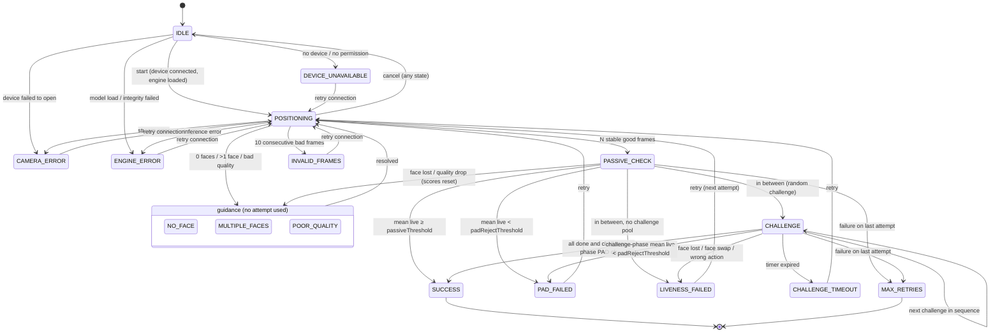
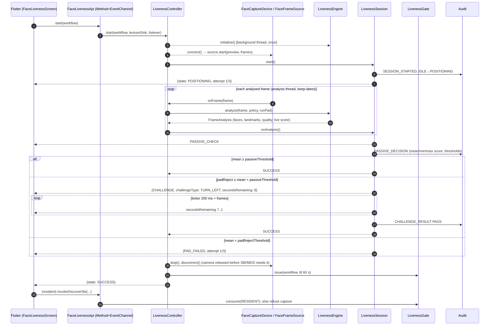

# Phase 1: Architecture and Interfaces

## 1. Module layout

New Gradle library **`:livenessmanager`** (Java 21, minSdk 28), next to `clientmanager`, `keymanager` and the other `*manager` modules.

```
android/livenessmanager/src/main/java/io/mosip/registration/livenessmanager/
├── api/        Contracts (no Android imports)
│   ├── FaceFrameSource        camera / vendor device / mock video → FaceFrame stream
│   ├── FaceCaptureDevice      device adapter: connect / disconnect / status (L0, L1)
│   ├── LivenessEngine         per-frame: faces, landmarks, quality, passive PAD score
│   │   ├── FaceDetector       (MediaPipe Face Landmarker)
│   │   ├── PadModel           (MiniFASNetV2 on ONNX Runtime)
│   │   └── QualityAnalyzer    (OpenCV; pure-Java twin for JVM tests)
│   ├── ChallengeManager       secure-random pick, timeout, attempt counting
│   ├── ChallengeDetector      blink / smile / head-turn per-frame check
│   ├── LivenessConfigProvider per-workflow policy, offline-first
│   ├── LivenessAuditLogger    the ONLY sink for scores / thresholds / model ids
│   ├── LivenessEventListener  UI-safe events (to Flutter)
│   └── PreviewSink            preview surface + transform (to a Flutter texture)
├── model/      Workflow, LivenessState, LivenessEvent, ChallengeType, QualityHint, FaceFrame, ...
├── core/       LivenessSession (state machine), LivenessController (wiring/threads), LivenessGate
├── challenge/  FaceGeometry (EAR, mouth ratio, yaw), Blink/Smile/HeadTurn detectors, RandomChallengeManager
├── quality/    QualityRules, LumaQualityAnalyzer
├── engine/     DefaultLivenessEngine (detector + PAD + quality composition)
├── config/     LivenessConfigParser, CanonicalJson (integrity digest), CachedLivenessConfigProvider
├── audit/      LivenessAuditRecord, NoOpLivenessAuditLogger
├── eval/       SessionReplay (offline harness), PadMetrics (APCER/BPCER)
└── android/    CameraX source, mock video source, device adapters, MediaPipe, ONNX, OpenCV, factory
```

Everything outside `android/` is plain Java, so the state machine, challenge logic, config and metrics are unit-tested on the JVM (69 tests, `./gradlew :livenessmanager:testDebugUnitTest`).

**Swapping a model or vendor:** implement `FaceDetector` or `PadModel` (one model), or `LivenessEngine` (a whole vendor engine), or `FaceCaptureDevice` (a vendor camera). The session, bridge and Flutter UI do not change.

## 2. State machine



State kinds (`LivenessState.Kind`):

| Kind | States | Attempt used? | UI action |
|---|---|---|---|
| ACTIVE | POSITIONING, PASSIVE_CHECK, CHALLENGE | no | none |
| GUIDANCE | NO_FACE, MULTIPLE_FACES, POOR_QUALITY | no | none, resolves automatically |
| ATTEMPT_FAILURE | LIVENESS_FAILED, PAD_FAILED, CHALLENGE_TIMEOUT | **yes** | Try again / Cancel |
| SYSTEM_ERROR | DEVICE_UNAVAILABLE, CAMERA_ERROR, INVALID_FRAMES, ENGINE_ERROR | no | Retry connection |
| TERMINAL | SUCCESS, MAX_RETRIES | n/a | Continue / Recovery options |

Rules worth calling out:
- Errors **fail closed**. No path reaches SUCCESS without a PAD score (an engine or model error goes to ENGINE_ERROR, never to a pass).
- During CHALLENGE, quality is not enforced (head turns blur), but face continuity is: losing the face for 3 frames, or a jump above 0.6 face-widths, fails the attempt. This stops "swap the photo for a live face mid-challenge".
- PAD keeps scoring during challenges. A video that performs the action but scores as an attack is still rejected.

## 3. Sequence: passive, then active, then result



## 4. Event payload (Java to Flutter)

EventChannel `io.mosip.registration_client/face_liveness/events`, one map per event:

| key | type | notes |
|---|---|---|
| `state` | String | one of the 16 `LivenessState` names |
| `workflow` | String | `RESIDENT`, `OPERATOR`, `SUPERVISOR` |
| `attempt` | int | 1-based; on a failure it is the attempt that failed |
| `maxAttempts` | int | from policy `maxRetries` |
| `challengeType` | String? | `BLINK`, `SMILE`, `TURN_LEFT`, `TURN_RIGHT` during CHALLENGE |
| `secondsRemaining` | int? | during CHALLENGE |
| `hint` | String? | `LIGHTING`, `FAR`, `BLURRY` during POOR_QUALITY, to pick the copy |

`LivenessEvent` has no field that can hold a score, threshold, model name or attack type. This is enforced by `PrivacyContractTest`.

## 5. Flutter bridge

MethodChannel `io.mosip.registration_client/face_liveness`:

| Method (Dart to native) | Args | Result |
|---|---|---|
| `isEnabled` | `{workflow}` | `bool` |
| `getMaxAttempts` | `{workflow}` | `int` |
| `start` | `{workflow}` | `{textureId:int}`; events follow on the EventChannel |
| `retry` | none | `null` |
| `cancel` | none | `null` (releases camera and texture) |
| `setSource` (debug builds only) | `{source: "camera" or "mock", path?, mirrored?}` | `bool` |

| Callback (native to Dart) | Args |
|---|---|
| `onPreviewTransform` | `{width, height, rotationDegrees, mirror}`: how to draw the raw texture upright |

Pigeon was not used for this channel: the project's Pigeon 10 has no event-stream support, and the brief asks for Method plus EventChannel.

## 6. Config

Schema: [`liveness-config.schema.json`](liveness-config.schema.json). Bundled default: `android/livenessmanager/src/main/assets/liveness/default_liveness_config.json`. Delivered as MOSIP global param **`mosip.registration.face.liveness.config`** (string = JSON), so it rides the existing syncdata channel. Example (synced form, with integrity):

```json
{
  "schemaVersion": 1,
  "configVersion": "2026.10.05-1",
  "livenessTokenTtlSeconds": 60,
  "performance": { "frameSkip": 1, "padEveryNthFrame": 1 },
  "policies": {
    "resident":   { "enabled": true,  "passiveThreshold": 0.9,  "padRejectThreshold": 0.3,
                    "challengeTypes": ["BLINK","SMILE","TURN_LEFT","TURN_RIGHT"], "challengeCount": 2,
                    "challengeTimeoutSeconds": 8, "maxRetries": 3, "minFaceSize": 0.25, "maxFaces": 1 },
    "operator":   { "enabled": true,  "passiveThreshold": 0.9,  "challengeTypes": ["BLINK","TURN_LEFT","TURN_RIGHT"],
                    "challengeCount": 2, "maxRetries": 3 },
    "supervisor": { "enabled": true,  "passiveThreshold": 0.92, "challengeCount": 2, "maxRetries": 3 }
  },
  "integrity": { "algorithm": "SHA-256", "value": "<sha256 of canonical JSON without 'integrity'>" }
}
```

Two fields were added beyond the brief, with the reason for each:
- `padRejectThreshold`: needed to produce PAD_FAILED distinctly from "low confidence, so challenge".
- `passiveFrames`, `positioningStableFrames`, `quality.*`, `performance.*`, `livenessTokenTtlSeconds`: tuning knobs that Phase 7 has to set per device class.

## 7. Decision log

| # | Decision | Why |
|---|---|---|
| D1 | In-app CameraX liveness **gates** the existing SBI capture; it does not replace it | SBI/MDS owns the signed biometric (MOSIP compliance). The app cannot see MDS frames. |
| D2 | Native single-use `LivenessGate` (TTL 60 s), checked in `BiometricsDetailsApi` | A UI bypass cannot skip liveness, and replaying an old pass is blocked |
| D3 | Operator/supervisor: liveness gate **after** the existing password auth; disabled by default | No face-login API exists. Without face matching, liveness alone is not authentication. |
| D4 | Method/EventChannel + Flutter `Texture` preview | Pigeon 10 has no streams. A Texture avoids PlatformView cost. |
| D5 | One analysis thread, keep-only-latest frames, `frameSkip` / `padEveryNthFrame` knobs | Bounded latency on low-end phones |
| D6 | Models pinned by SHA-256, loaded from memory; any failure is ENGINE_ERROR | Fail closed, plus model provenance |
| D7 | Default `challengeCount` = 2 | The synthetic replay study showed 1 BLINK challenge is beaten by a natural-blink replay (APCER 0.32 vs 0.00) |
| D8 | Config integrity = SHA-256 over canonical JSON; authenticity comes from the authenticated MOSIP sync channel | A digest detects corruption, not a malicious server. Signature verification with the MOSIP sign cert is listed as future work. |
